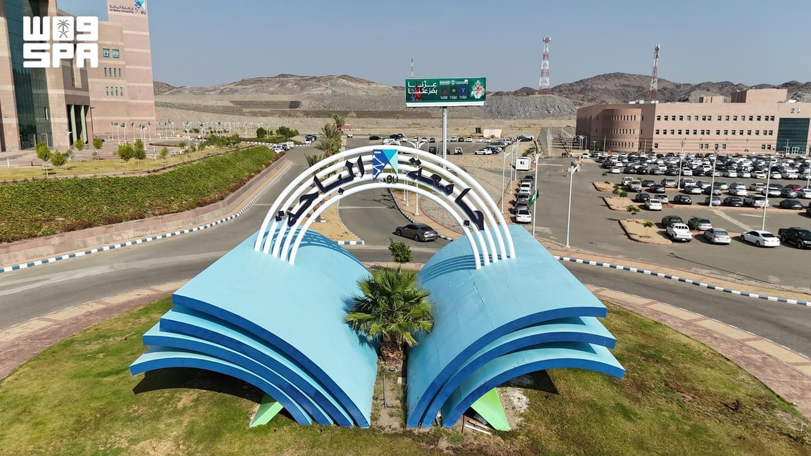

# Saudi institutes advance in global education rankings

- JEDDAH: Three Saudi universities have advanced in the Times Higher Education World University Rankings 2027, reflecting efforts to strengthen teaching, research, international partnerships and industry cooperation.
- Prince Mohammad bin Fahd University ranked in the 401-450 band globally, placing it among Saudi Arabia’s top five universities.
- Shaqra University advanced to the 801-1000 band, while Al-Baha University ranked in the 1201-1400 band.

## Story

JEDDAH: Three Saudi universities have advanced in the Times Higher Education World University Rankings 2027, reflecting efforts to strengthen teaching, research, international partnerships and industry cooperation.

Prince Mohammad bin Fahd University ranked in the 401-450 band globally, placing it among Saudi Arabia’s top five universities. Shaqra University advanced to the 801-1000 band, while Al-Baha University ranked in the 1201-1400 band.

Prince Mohammad bin Fahd University’s performance reflects efforts to improve education, research and innovation and expand international partnerships.

The university is developing its academic and research environment in line with international standards and preparing graduates to compete globally and contribute to a knowledge-based economy.

- Source: Arab News
- Related: [[Kingdom calls for global cooperation on child safety]], [[Two Mongolian saker falcons fetch $147,000 at Riyadh hunting exhibition]], [[KAUST develops sensor for potential early detection of Parkinson’s]]

Back to [[Saudi Arabia]].
