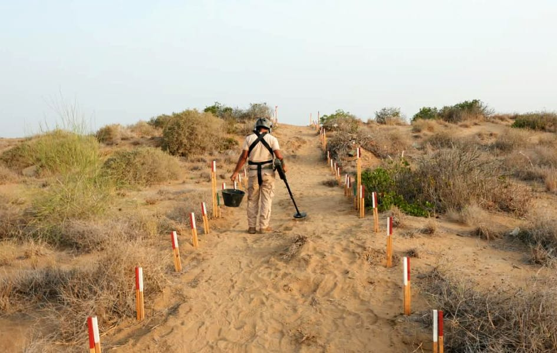

# Saudi project clears 1,256 mines in Yemen

- RIYADH: Members of Saudi Arabia’s Masam project removed 1,256 explosive devices from various regions of Yemen last week.
- These include 1,201 items of unexploded ordnance, 41 anti-tank mines, and 14 anti-personnel mines, according to a recent report.
- The explosives were planted indiscriminately across the country, posing a threat to civilians, including children, women, and the elderly.

## Story

RIYADH: Members of Saudi Arabia’s Masam project removed 1,256 explosive devices from various regions of Yemen last week.

These include 1,201 items of unexploded ordnance, 41 anti-tank mines, and 14 anti-personnel mines, according to a recent report.

The explosives were planted indiscriminately across the country, posing a threat to civilians, including children, women, and the elderly.

The demining operations took place in Marib, Aden, Jouf, Shabwa, Taiz, Hodeidah, Lahij, Sanaa, Al-Bayda, Al-Dhale, and Saada.

- Source: Arab News
- Related: [[Israeli forces blow up school, burn homes in southern Lebanon, Lebanese]], [[Al-Alimi announces launch of military operations against Houthi militias]], [[Saudi Arabia opens October ‘Sah’ sukuk with 5 percent annual return]]

Back to [[Saudi Arabia]].
