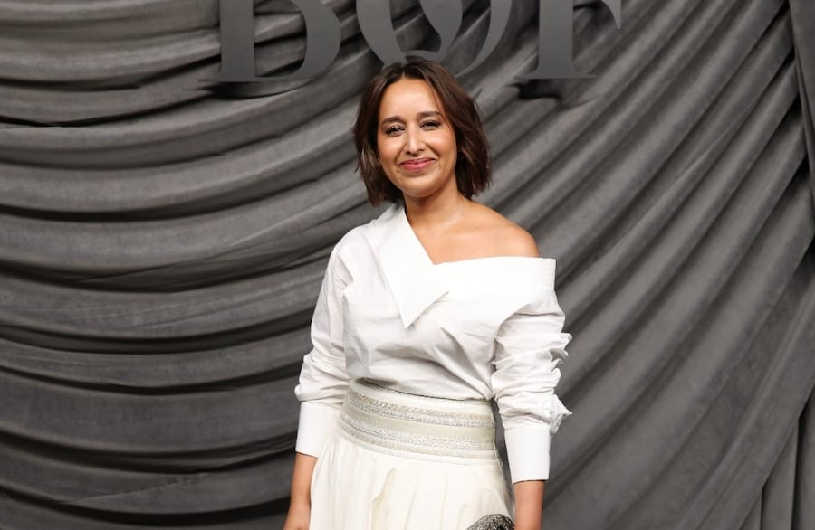

# Shahd Al-Shehail attends BoF 500 Gala in Paris

- DUBAI: Saudi designer Shahd Al-Shehail is among the Arab figures recognized in the 2026 Business of Fashion 500, the annual index of people shaping the global fashion industry, and she was on hand in Paris on Saturday night to celebrate at the BoF 500 Gala during Paris Fashion Week.
- Al-Shehail, founder of Saudi fashion label Abadia, joins Kuwaiti entrepreneur Zainab Alabdulrazzaq, Lebanese fashion educator Sarah Hermez and Egyptian actress and singer Yasmina El-Abd on this year’s list.

## Story

DUBAI: Saudi designer Shahd Al-Shehail is among the Arab figures recognized in the 2026 Business of Fashion 500, the annual index of people shaping the global fashion industry, and she was on hand in Paris on Saturday night to celebrate at the BoF 500 Gala during Paris Fashion Week.

Al-Shehail, founder of Saudi fashion label Abadia, joins Kuwaiti entrepreneur Zainab Alabdulrazzaq, Lebanese fashion educator Sarah Hermez and Egyptian actress and singer Yasmina El-Abd on this year’s list. Their inclusion reflects the growing influence of the Middle East’s fashion and creative industries on the international stage.

Al-Shehail founded Abadia in 2019 as an ethical fashion house rooted in Saudi heritage, craftsmanship and cultural storytelling. The label explores traditional techniques alongside contemporary silhouettes and became the first Saudi brand to join Net-a-Porter in 2021, giving its approach to local craft an international platform.

Alabdulrazzaq, meanwhile, is the founder of 3oud.com, a fashion and digital media platform established in Kuwait in 2015. The site has covered regional and international fashion through runway reports, interviews and brand collaborations.

- Source: Arab News
- Related: [[Saudi institutes advance in global education rankings]], [[Kuwaiti artist Aseel Al-Yaqoub wins Ithra Art Prize 2026]], [[Beyond the runway BRICS+ Fashion Summit panel calls for fashion weeks to]]

Back to [[Lifestyle]].
