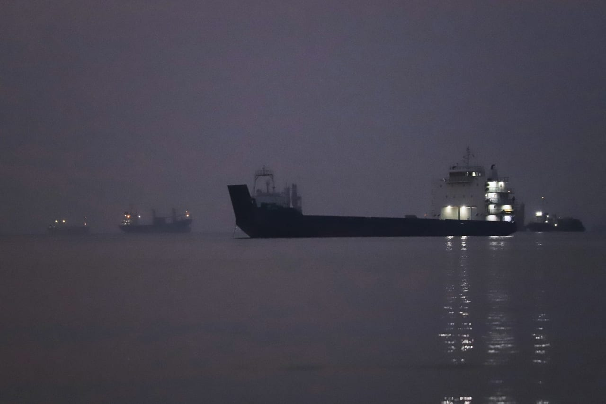

# Tanker damaged after attack in Hormuz maritime agency

- A tanker in the Strait of Hormuz sustained damage following an attack targeting its engine room.
- This incident highlights ongoing tensions as Iran seeks control over the key shipping lane.

## Story

DUBAI: An attack on a tanker in the Strait of Hormuz damaged its engine room, a British maritime agency said Sunday, without specifying when the incident occurred.

Iran has sought to impose control over the vital shipping lane since the start of its war with the United States and Israel.

It has repeatedly targeted vessels in the waterway that it accuses of transiting without its authorization, while the United States has struck ships allegedly attempting to skirt a counterblockade of Iranian ports.

An “unknown projectile” struck the ship but the crew were unharmed, the United Kingdom Maritime Trade Operations Centre (UKMTO) said.

- Source: Arab News
- Related: [[Will Malacca Strait become the next maritime flashpoint]], [[Iran says Strait of Hormuz will not reopen until conditions are met]], [[Chokepoint diplomacy weaponizing maritime geography]]

Back to [[Middle East]].
