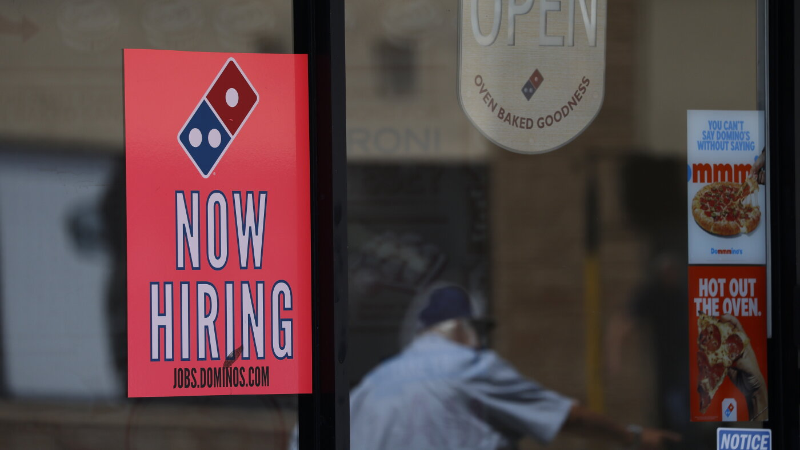

# The U.S. added only 29,000 jobs in September as job market lacks spark

- employers added 29,000 jobs in September as the unemployment rate inched up to 4.
- Job gains for July and August were revised down by a total of 60,000 jobs, extending a lackluster run for the job market.

## Story

Restaurants and bars added 11,000 jobs in September, about a third of all the jobs added during the month. Job gains for July and August were revised downward. Justin Sullivan/Getty Images hide caption

The U.S. job market showed signs of weakness in September as hiring slowed and the unemployment rate inched higher.

A report from the Labor Department on Friday shows employers added just 29,000 jobs last month — far fewer than forecasters had expected. Job gains for July and August were also revised down by a total of 60,000, pushing July's job totals into the red.

The September report doesn't show widespread job cuts, although financial services and government shed workers. Most industries continued to add workers, but at a slow pace. Even healthcare, which has been a steady source of employment gains, added just 17,000 jobs last month.

- Source: NPR
- Related: [[Economist Betsey Stevenson breaks down the gender gap in recent hiring]]

Back to [[Business News]].
