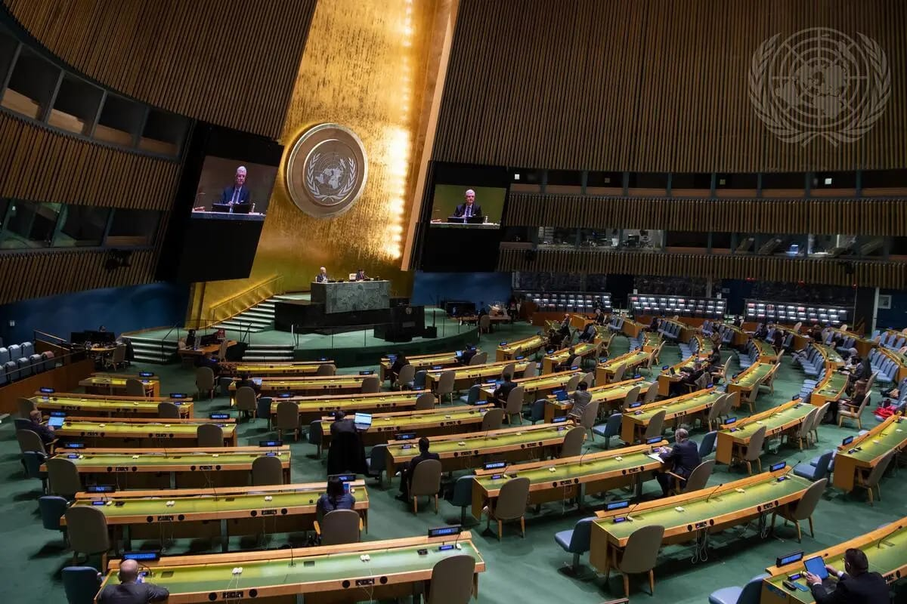

# The world now has two Myanmars

- Walking through the UN General Assembly in New York this year, one of the more striking diplomatic contradictions concerned Myanmar.
- For most countries represented at the UN, there is little ambiguity about who speaks for the state.
- Governments appoint ambassadors, ambassadors represent governments and both claim authority over the same country.

## Story

Walking through the UN General Assembly in New York this year, one of the more striking diplomatic contradictions concerned Myanmar.

For most countries represented at the UN, there is little ambiguity about who speaks for the state. Governments appoint ambassadors, ambassadors represent governments and both claim authority over the same country. Myanmar was different. Its presence at the UN exposed a question that runs through the country’s entire political crisis: who actually speaks for Myanmar?

At the UN, Myanmar continues to be represented by Ambassador Kyaw Moe Tun, who publicly rejected the military takeover of February 2021 and remains an outspoken opponent of military rule. The authorities in Naypyitaw insist that he was dismissed years ago and again challenged his status shortly before this year’s UNGA. Yet he remains in place.

Outside the UN, however, another Myanmar is taking shape. Across Asia, governments are increasingly dealing with the military-backed authorities in Naypyitaw on trade, refugees, borders, investment and diplomacy. In New York, one Myanmar speaks in the language of democratic legitimacy. Across the region, another is increasingly treated as the authority with which practical business must be done. The world, in effect, now has two Myanmars.

- Source: Arab News
- Related: [[India’s ‘cleanest village’ bars visitors on Sundays to regain peace]], [[Kingdom calls for global cooperation on child safety]]

Back to [[Opinion]].
