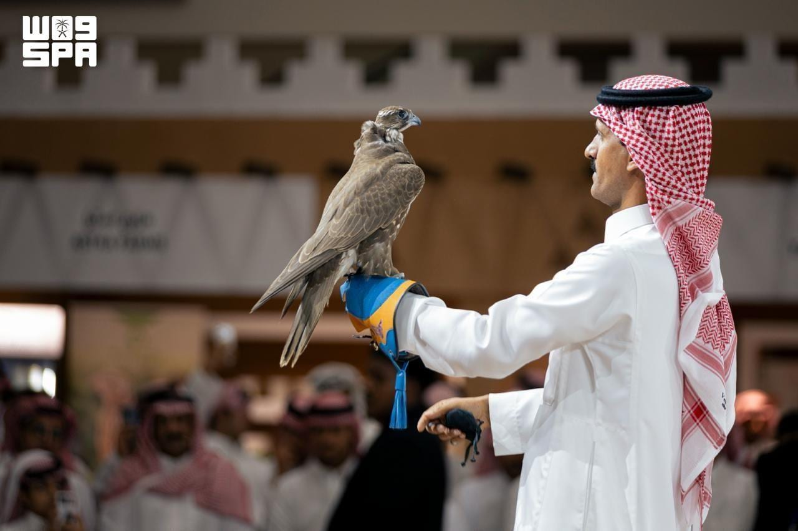

# Two Mongolian saker falcons fetch $147,000 at Riyadh hunting exhibition

- RIYADH: Two Mongolian saker falcons sold for a combined SR550,000 ($147,000) at the opening auction of the International Saudi Falcons and Hunting Exhibition, highlighting strong demand among falconry enthusiasts in the Kingdom.
- A young saker falcon was sold for SR150,000, while an adult bird fetched SR400,000 after competitive bidding, according to Akhbaar24.

## Story

RIYADH: Two Mongolian saker falcons sold for a combined SR550,000 ($147,000) at the opening auction of the International Saudi Falcons and Hunting Exhibition, highlighting strong demand among falconry enthusiasts in the Kingdom.

A young saker falcon was sold for SR150,000, while an adult bird fetched SR400,000 after competitive bidding, according to Akhbaar24.

The exhibition has a section dedicated to Mongolian falcons for the second successive year, reflecting their growing appeal among Saudi falconers.

The Mongolian saker is particularly valued for its large size, broad wingspan and endurance, qualities that have made it one of the most sought-after falcons in the region. Its varied plumage, ranging from light tones to dark brown shades, also contributes to its value, with individual characteristics often influencing auction prices.

- Source: Arab News
- Related: [[Saudi exhibition traces kings’ bond with falconry through rare]], [[Saudi tourism facilities expand 18 percent as hospitality supply grows]], [[King Salman invites Qatar emir to GCC-EU Summit to be held in October]]

Back to [[Saudi Arabia]].
