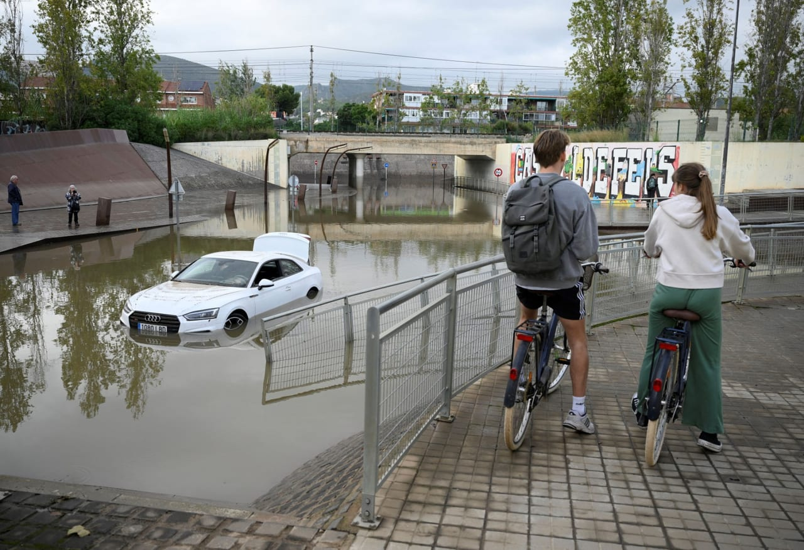

# Two dead in flooding in Spain’s Catalonia region

- Two people have died and one is missing following severe floods in Catalonia, Spain.
- Authorities continue search efforts for the missing individual.

## Story

Two people have ‌died and another was missing after heavy rains and flooding in Spain’s Catalonia region, authorities said on Sunday.

Catalan leader Salvador Illa confirmed the death of a man after a wall collapsed in Tordera, a town to the north of Barcelona, in a message on his social media account on Sunday. Another person died ‌in Montornès del ‌Vallès, firefighters said on Sunday, ‌while emergency services were searching for a missing person in Pineda de Mar, a town 52 km (32 miles) to the north of Barcelona.

Catalan authorities issued a red alert warning and urged people to stay inside from 8 p.m. (1800 GMT) on Saturday until Sunday ‌at 2 ‌p.m. (1200 GMT) because a “mini-hurricane” could hit the northeastern region, ‌with more heavy rain forecast. Homes were ‌flooded and cars left submerged in Bellvitge and Cornella near Barcelona after torrential rain on Saturday. Ducks swam in huge puddles that ‌formed on motorways in Barcelona. Sarai Sarroca, director of regional weather service Meteocat, said on Saturday that the core of an exceptional weather system was over the Mediterranean and a “mini-hurricane” could move over land in Catalonia.

Flights were cancelled or delayed at Barcelona airport, La Vanguardia newspaper reported on Saturday.

- Source: Arab News

Back to [[World]].
