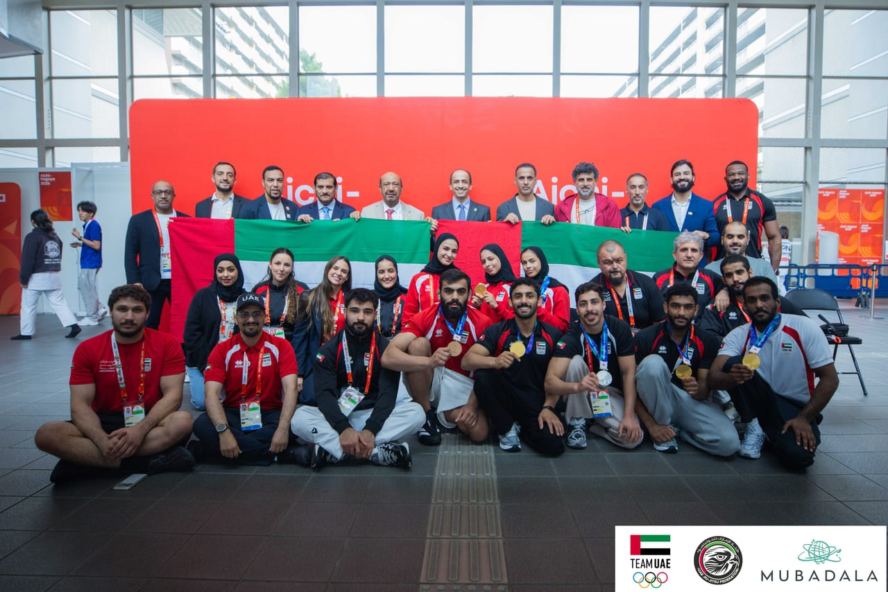

# UAE tops Asian Games jiu-jitsu standings with record 5 golds

- The UAE’s jiu-jitsu national team achieved a historic performance at the 20th Asian Games in Aichi-Nagoya by winning a record five gold medals, topping the medal standings.
- Overall, the team secured eight medals, including two silvers and one bronze, surpassing their previous best of four golds at the Hangzhou 2022 Games.

## Story

DUBAI: The UAE’s jiu-jitsu national team topped the medal table at the 20th Asian Games — Aichi-Nagoya 2026, finishing with five golds as three days of competition came to a close on Saturday.

The UAE finished with eight medals, including five golds, two silvers and one bronze. Balqees Al-Hashmi (women’s 48 kg), Khaled Al-Shehhi (men’s 62 kg), Ahmed Andeez (men’s 69 kg), Mahdi Al-Awlaqi (men’s 77 kg) and Asma Al-Hosani (women’s 52 kg) won gold.

Al-Anoud Al-Harbi (women’s 48 kg) and Omar Al-Suwaidi (men’s 62 kg) took silver, while Amaar Al-Hosani (men’s 94 kg) secured bronze.

The five titles mark the UAE’s best-ever Asian Games gold medal haul in jiu-jitsu, beating its previous best of four at Hangzhou 2022 (held in 2023). The team had also won two golds at Jakarta 2018.

- Source: Arab News
- Related: [[Bahrain tops Arab nations at Asian Games with 22 medals]], [[Al-Dahami grabs show jumping gold as Saudi Arabia ends Asian Games with]], [[Saudi and Moroccan Derbies take Kings League MENA centerstage as Ultra]]

Back to [[Sport]].
