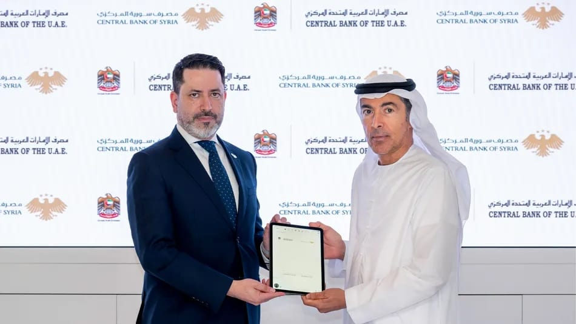

# UAE, Syria central banks sign MoU to deepen financial cooperation

- RIYADH: The central banks of the UAE and Syria signed a memorandum of understanding on financial and technical cooperation, as the two countries seek to strengthen banking ties and exchange regulatory expertise.
- The agreement was signed by Khaled Mohamed Balama, governor of the Central Bank of the UAE, and Mohammad Safwat Abdel Hamid Raslan, governor of the Central Bank of Syria, according to the Emirates News Agency, or WAM.

## Story

RIYADH: The central banks of the UAE and Syria signed a memorandum of understanding on financial and technical cooperation, as the two countries seek to strengthen banking ties and exchange regulatory expertise.&nbsp;

The agreement was signed by Khaled Mohamed Balama, governor of the Central Bank of the UAE, and Mohammad Safwat Abdel Hamid Raslan, governor of the Central Bank of Syria, according to the Emirates News Agency, or WAM.&nbsp;

The MoU provides a framework for cooperation on institutional capacity building, technical expertise and regulatory frameworks, with the two central banks set to exchange knowledge in areas of mutual interest.&nbsp;

The agreement comes as Syria seeks to expand its banking sector and attract foreign investment. In September, Raslan said foreign capital for establishing new banks was expected to exceed $1 billion, as the country seeks to restore links with international financial networks.&nbsp;

- Source: Arab News
- Related: [[GCC tops global remittance outflows at $161bn]], [[Kingdom calls for global cooperation on child safety]], [[King Salman invites Qatar emir to GCC-EU Summit to be held in October]]

Back to [[Business]].
