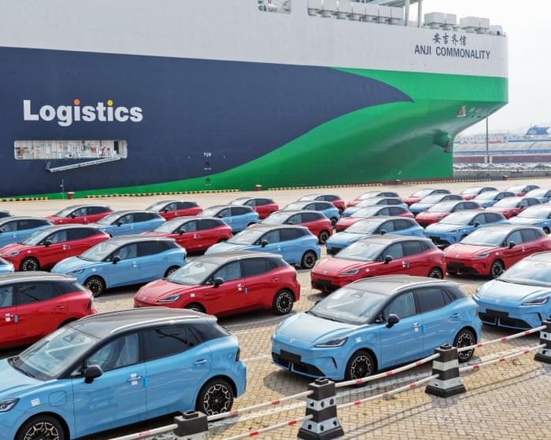

# UK car industry faces ‘difficult trade-off’ between Chinese and EU

- Britain under pressure to put tariffs on cheap Chinese vehicle imports ahead of protectionist trade measures Britain’s car industry is grappling with a “difficult trade-off” between China and Europe, as manufacturers struggle to balance the benefits of both markets ahead of looming trade measures that could restrict UK exports to the EU.
- The UK is an outlier in choosing not to put import taxes on Chinese vehicles, even as the US has shut them out almost entirely , and the EU imposes duties of up to 45% .

## Story

Britain under pressure to put tariffs on cheap Chinese vehicle imports ahead of protectionist trade measures

Britain’s car industry is grappling with a “difficult trade-off” between China and Europe , as manufacturers struggle to balance the benefits of both markets ahead of looming trade measures that could restrict UK exports to the EU.

The UK is an outlier in choosing not to put import taxes on Chinese vehicles, even as the US has shut them out almost entirely , and the EU imposes duties of up to 45% .

EU officials reportedly warned Andy Burnham last month that the UK must put tariffs on cheap Chinese vehicles otherwise Brussels would impose protectionist “made in Europe” barriers on British exports to the bloc, hitting British carmakers in their largest market.

- Source: Guardian
- Related: [[Max Verstappen wins chaotic F1 Bahrain GP in Malaysia after rain causes]], [[Modric ‘ashamed’ after 7-0 defeat by England; Republic of Ireland v]], [[Row erupts over Cairo mural depicting Tutankhamun and Nefertiti with]]

Back to [[Business News]].
