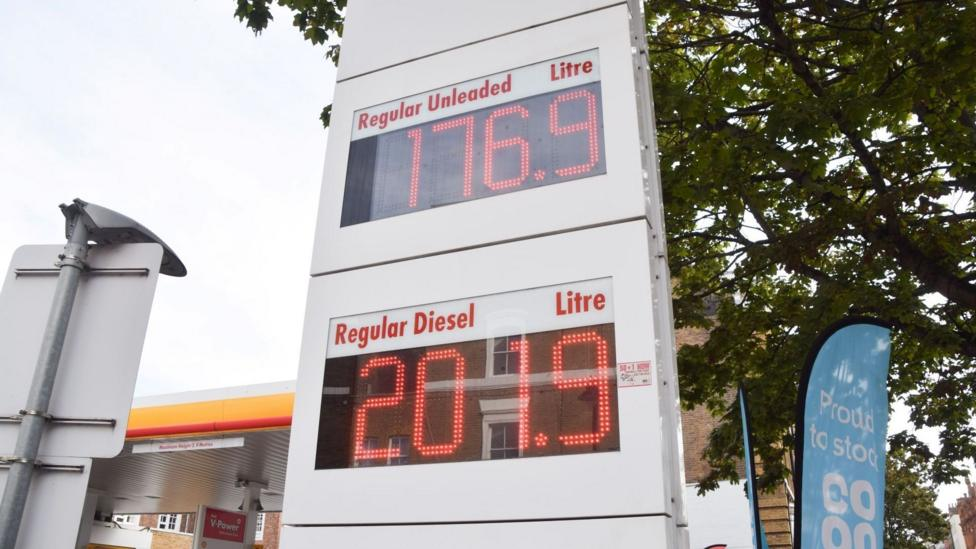

# UK diesel prices top £2 a litre for first time, RAC says

- The rise in global oil prices has been pushing up the pump prices of petrol and diesel in the UK.

- Source: BBC

Back to [[Business News]].
