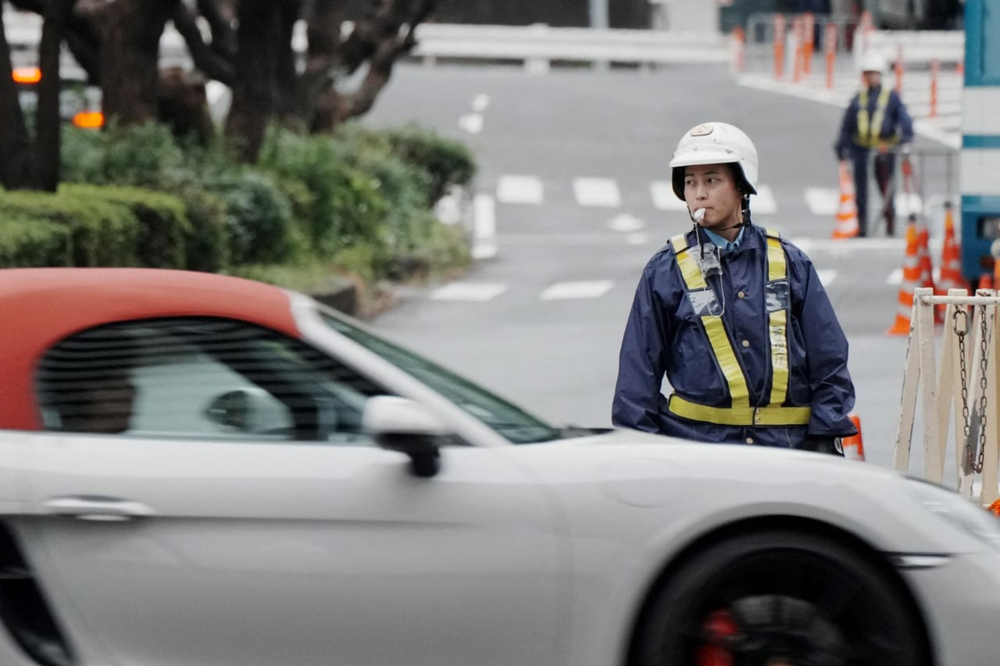

# US Marine arrested in Japan on suspicion of murder

- A US Marine in Okinawa, Japan, was arrested for allegedly murdering and robbing a Japanese woman.
- The US Ambassador has extended condolences and assured cooperation with the investigation.

## Story

Tokyo: A US Marine stationed on Japan’s southern island of Okinawa was arrested on suspicion of the murder of a Japanese woman, police said on Sunday.

The suspect “killed the 39-year-old woman at a hotel in Naha and stole her wallet on Saturday,” a local police spokesman told AFP.

US Ambassador George Glass posted on social media that he had spoken with Japan’s foreign ministry and Okinawa’s governor to offer “our sincere condolences and pledging full cooperation as the investigation continues”.

The government has urged the US “to provide maximum cooperation with the investigation, enforce stricter discipline among US military personnel, and take thorough measures to prevent the recurrence of similar crimes,” Takaichi said.

- Source: Arab News

Back to [[World]].
