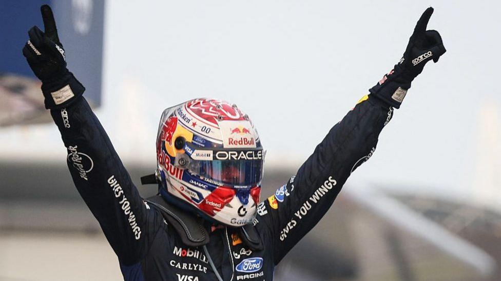

# Verstappen wins in Malaysia after long delays as Russell retires

- Max Verstappen takes his and Red Bull's first win of the year with a dominant drive in a dramatic Bahrain Grand Prix in Malaysia that started amid chaotic and unprecedented scenes.

- Source: BBC
- Related: [[Max Verstappen wins chaotic F1 Bahrain GP in Malaysia after rain causes]]

Back to [[Sport News]].
