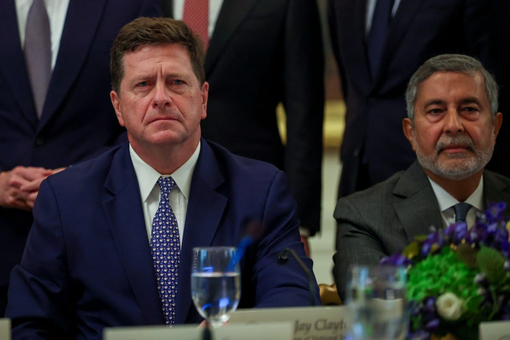

# White House AI task force will prevent ‘overregulation’ WSJ

- The White House has established a task force to evaluate AI risks and opportunities, aiming to prevent overregulation that might hinder innovation.

## Story

NEW YORK: A White House task force on artificial intelligence will assess the technology’s risks and opportunities, while preventing overregulation that stifles innovation, its leader Jay Clayton has told the Wall Street Journal.

Clayton, the US director of national intelligence, is widely reported to be the new AI czar in the administration of US President Donald Trump, though the appointment is yet to be confirmed.

Clayton would become the second person to hold the informal title after venture capitalist David Sacks, who held the role at the start of Trump’s second term before stepping down.

The new “Super Intelligence Force” -- using Trump’s preferred term for artificial intelligence -- will have 120 days to report on the risks and opportunities of the technology, the Journal reported on Saturday.

- Source: Arab News

Back to [[World]].
