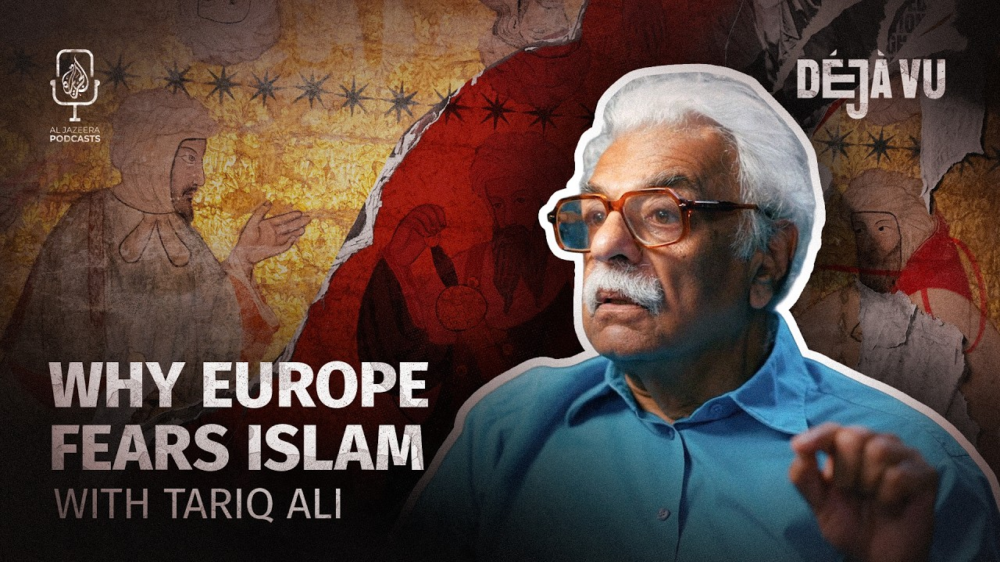

# Why does Europe want to erase its Muslim history Tariq Ali Deja Vu

[video](youtube:fnPJcjzy8fk)

- From Spain to Sicily, Muslims helped shape Europe for centuries.
- Why do they still seem to be cast as outsiders?

- Source: Al Jazeera

Back to [[Video News]].
