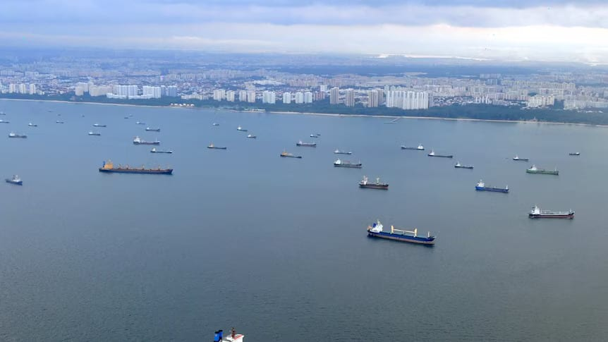

# Will Malacca Strait become the next maritime flashpoint

- Developments in the Strait of Hormuz reverberated 6,500 km away when, in late April, Indonesian Finance Minister Purbaya Yudhi Sadewa, noting that Iran was planning to charge ships passing through Hormuz, said: “We sit along a key global trade and energy route, yet ships passing through the Malacca Strait are not charged.
- ” He mused that the income from tolls at Malacca could be split three ways between the littoral states of Indonesia, Malaysia and Singapore.

## Story

Developments in the Strait of Hormuz reverberated 6,500 km away when, in late April, Indonesian Finance Minister Purbaya Yudhi Sadewa, noting that Iran was planning to charge ships passing through Hormuz, said: “We sit along a key global trade and energy route, yet ships passing through the Malacca Strait are not charged.” He mused that the income from tolls at Malacca could be split three ways between the littoral states of Indonesia, Malaysia and Singapore.

In response, Singaporean Foreign Minister Vivian Balakrishnan, reflecting his country’s commitment to free navigation, categorically rejected the idea of tolls. Malaysia did not reject tolls outright; its foreign minister only said that a decision needed to be taken consensually by the countries concerned. However, despite these disclaimers, the idea that some form of disruption could take place at Malacca has now been implanted in the global consciousness.

The Malacca Strait stretches nearly 900 km from the Indonesian island of Sumatra in the west, past southern Thailand and Malaysia, and ends at Singapore. It links the Andaman Sea with the South China Sea and is the shortest maritime link from Europe and the Middle East to Southeast Asia and the Western Pacific. The width of the strait varies from a narrow 2.8 km off Singapore to 250 km at its widest. Its depth just south of the Andaman basin is about 200 meters but this reduces to 25 meters at its southern end.

More than 100,000 vessels pass through the strait annually, carrying about 25 percent to 30 percent of global cargo, valued at $3.5 trillion. This cargo includes 35 percent of oil transported by sea — about 23 million barrels per day — and 20 percent of liquefied natural gas. Between 75 percent and 80 percent of the global trade of China, Japan and South Korea passes through the Malacca Strait, making the waterway the world’s busiest chokepoint. It has been described as “the irreplaceable heart of global maritime trade.” Besides oil and gas, the strait carries agricultural products, chemicals, consumer goods, manufactured products, machinery, textiles, electronics and, in recent times, rare earth minerals, lithium and cobalt.

- Source: Arab News
- Related: [[Tanker damaged after attack in Hormuz maritime agency]], [[Chokepoint diplomacy weaponizing maritime geography]], [[Iran FM tells US there is no military solution to their conflict]]

Back to [[Opinion]].
