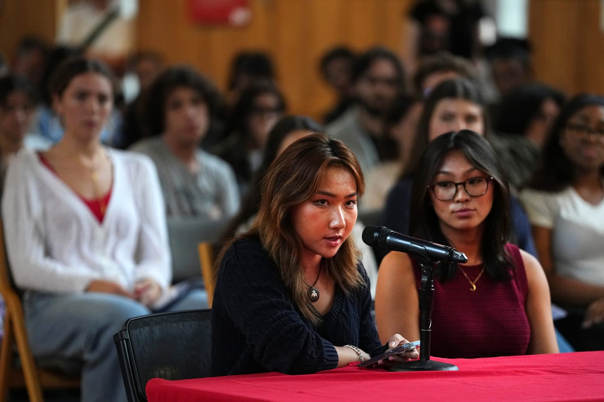

# Woman at center of Cornell rape allegations targeted with threats,

- WASHINGTON: The woman who has alleged that she was drugged and raped by Cornell University students has been the target of threats, her lawyer said on Sunday.
- Thomas Giuffra, who represents the woman identified as “Jane Doe,” told CNN that people have threatened to silence or harm her if she does not withdraw her ‌civil lawsuit ‌alleging that several members of a Cornell ‌fraternity drugged and raped her in 2024.
- “She’s received multiple threats,” Giuffra said on CNN’s “State of the Union.

## Story

WASHINGTON: The woman who has alleged that she was drugged and raped by Cornell University students has been the target of threats, her lawyer said on Sunday.

Thomas Giuffra, who represents the woman identified as “Jane Doe,” told CNN that people have threatened to silence or harm her if she does not withdraw her ‌civil lawsuit ‌alleging that several members of a Cornell ‌fraternity drugged and raped her in 2024.

“I’m not afraid of these people,” he said. “But the threats, the abuse to protect what’s going on, the status quo — these guys are disgusting. They should stay in their mother’s basement and stay out of the world.”

Cornell ‌University President Michael Kotlikoff ‌said in a video message on Saturday that the university will ‌examine the role of fraternities and sororities on campus ‌following the outcry over the school’s handling of the rape allegations.

- Source: Arab News
- Related: [[Israeli forces fire tear gas at Palestinians after settlers reportedly]]

Back to [[World]].
