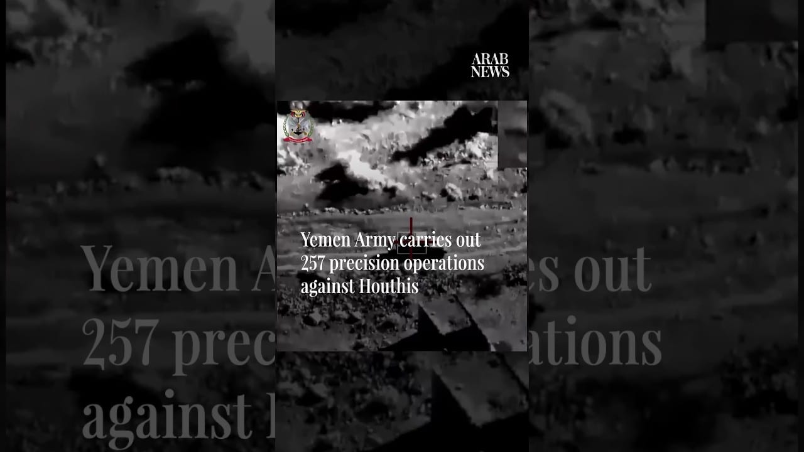

# Yemen Army carries out 257 precision operations against Houthis

[video](youtube:o07m3ZGyd6E)

- Yemen's armed forces said they carried out 257 precision operations against Houthi positions and military capabilities using aircraft, drones, artillery, missiles and rocket launchers.

- Source: Arab News
- Related: [[Yemeni forces say they struck Houthi targets in Saada]], [[Al-Alimi announces launch of military operations against Houthi militias]], [[Yemeni forces repel major Houthi assaults in Taiz, strike targets in]]

Back to [[Video]].
