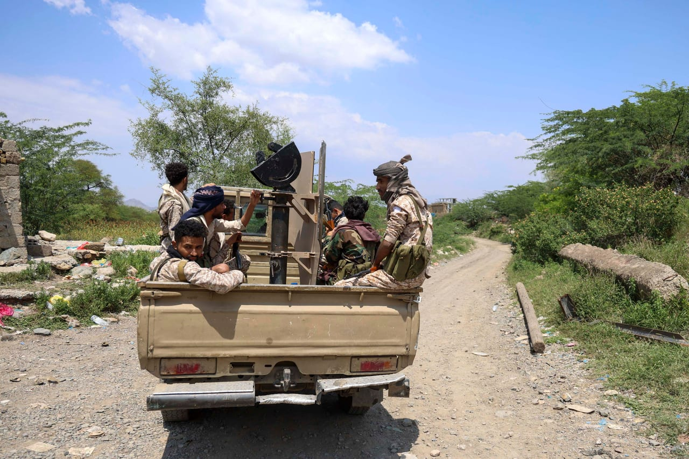

# Yemeni forces repel major Houthi assaults in Taiz, strike targets in

- Yemeni government forces successfully repelled aggressive assaults from Iran-backed Houthis in Taiz, marking some of the most intense fighting in the conflict's 12-year history.
- The Houthis, who have intensified their attacks on Taiz city and other districts, faced significant losses, while Yemeni forces also launched strikes on military targets in Houthi-controlled Sanaa.

## Story

AL-MUKALLA: Yemeni government forces in the southwestern province of Taiz on Saturday repelled what local army officers described as some of the most “aggressive” assaults by the Iran-backed Houthis, as the army also launched strikes on targets in Houthi-controlled Sanaa.

Local army commanders said the Houthis heavily shelled government-controlled areas across the province, including Taiz city, firing hundreds of rounds from different weapons while deploying large numbers of infantry in an attempt to overwhelm government defensive positions.

“By God, I have never seen such aggressive assaults and battles as today. This is one of the most intense battles of the war over the past 12 years,” Col. Abdul Basit Al-Baher, a Yemeni army officer in Taiz, told Arab News.

A month ago, the Houthis launched their largest military operation against Yemeni government forces in years in the western provinces of Taiz and Hodeidah, deploying thousands of fighters and launching barrages of missiles and drones.

- Source: Arab News
- Related: [[Yemeni forces say they struck Houthi targets in Saada]], [[Al-Alimi announces launch of military operations against Houthi militias]], [[Chokepoint diplomacy weaponizing maritime geography]]

Back to [[Middle East]].
