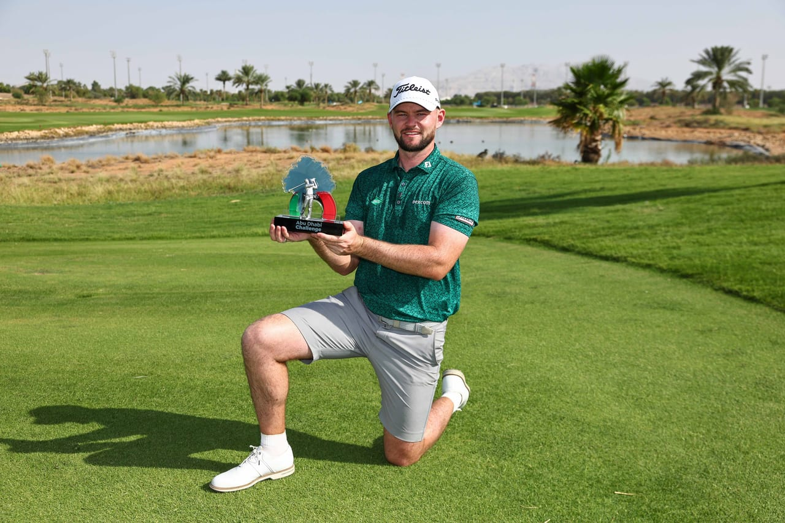

# ‘Special course’ Liam Nolan claims maiden title in style at Abu Dhabi

- Ireland’s Liam Nolan secured his first HotelPlanner Tour title at the Abu Dhabi Challenge, winning by four strokes with a final round of five-under-par 65.
- His victory elevates him to 12th place in the Road to Mallorca Rankings, enhancing his chances for a DP World Tour card for 2027.
- Nolan celebrated the win with his caddie and family, emphasizing the support and teamwork behind his success.

## Story

ABU DHABI: Ireland’s Liam Nolan won his first HotelPlanner Tour title in fine style at the Abu Dhabi Challenge, holding his nerve to close out a four-stroke victory at the Al-Ain Equestrian, Shooting and Golf Club in the Al-Ain Region.

The 26-year-old from Galway started the final round two clear. He closed with a five-under-par 65 to finish on 21 under par, four ahead of Finland’s Tapio Pulkkanen, with Italy’s Matteo Cristoni a further shot back in third.

Nolan made his move early. After three opening pars, he birdied the drivable par-four fourth and then rattled off three in a row from the sixth, holing a monster putt at the eighth to turn in 31. Pulkkanen had bogeyed the first, and from there, Nolan’s lead never dropped below three. When the Finn birdied the 12th, Nolan responded immediately with a pinpoint approach at the 13th to reach 21 under. He dropped his only shot of the day at the 16th before signing off with a birdie at the par-five 18th.

A crowd turned out to watch Nolan secure the title. They followed him up the 18th fairway and gathered round the final green as he completed the win.

- Source: Arab News
- Related: [[Qatar coach Lopetegui praises ‘very strong’ Saudi fans after penalty]], [[Bahrain tops Arab nations at Asian Games with 22 medals]], [[Al-Dahami grabs show jumping gold as Saudi Arabia ends Asian Games with]]

Back to [[Sport]].
