# Field of View

Field of view (FOV) is how much of the scene is visible at once, measured in degrees.

- Human binocular vision spans roughly 200 degrees horizontally; consumer headsets are usually about 90 to 110 degrees.
- Set by the optics of the [[Head-Mounted Display]], e.g. a [[Fresnel Lens]].
- A narrow FOV feels like looking through goggles and hurts immersion in [[Virtual Reality]].
- In [[Three.js]] a `PerspectiveCamera` takes a vertical FOV, but in XR the headset supplies it.
- Wide FOV raises rendering cost, see [[Frame Rate]]. It can also raise [[Motion Sickness]] risk because of stronger peripheral motion cues.

Back to [[Index]].
