# Fresnel Lens

A lens made of concentric ridges that reproduces the curvature of a thick lens in a thin, light profile. Named after Augustin-Jean Fresnel, who developed it for lighthouses.

- Used in many early consumer [[Head-Mounted Display]] designs to keep headsets light.
- Can produce "god rays", streaks of light around high-contrast edges.
- Pancake lenses later made headsets thinner still.
- Distortion is corrected in software, see [[Stereoscopic Rendering]] and [[Shaders]].
- Sweet spot size interacts with [[Interpupillary Distance]].

Back to [[Index]].
