# Interpupillary Distance

Interpupillary distance (IPD) is the distance between the centers of the pupils. The adult average is roughly 63 mm, with a typical range of about 54 to 74 mm.

- Headsets adjust lens spacing to match it, see [[Head-Mounted Display]].
- The renderer separates the two virtual cameras by the IPD, see [[Stereoscopic Rendering]].
- A wrong setting hurts depth perception and can add to [[Motion Sickness]].
- Interacts with the [[Fresnel Lens]] sweet spot.

Back to [[Index]].
