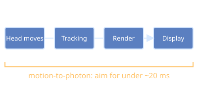

# Latency

In VR the key figure is motion-to-photon latency: the time between a head movement and the display updating to match.

- A common comfort target is under about 20 ms.
- Driven by tracking delay, rendering time ([[Frame Rate]]) and display scan-out.
- High latency breaks the sense of presence in [[Virtual Reality]] and leads to [[Motion Sickness]].
- Headsets use late-latching and reprojection to predict pose, which relies on accurate [[Six Degrees of Freedom]] data.
- [[Spatial Audio]] also needs low latency to stay anchored to sources.

Back to [[Index]].
