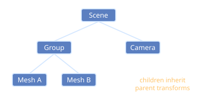

# Scene Graph

A tree of objects where each node's transform is relative to its parent.

- Moving a parent moves all its children, e.g. a hand holding a sword.
- In [[Three.js]] every `Object3D` is a node; call `parent.add(child)`.
- Each node stores position, scale and a [[Quaternions|rotation quaternion]].
- [[VR Controllers]] and [[Spatial Audio]] sources are attached as nodes.
- Culling and traversal decide what is drawn each frame, which affects [[Frame Rate]].

Back to [[Index]].
