# Six Degrees of Freedom

6DoF means tracking both position (x, y, z translation) and orientation (pitch, yaw, roll).

- 3DoF only tracks rotation, as in older mobile headsets.
- Orientation is commonly stored as [[Quaternions]] to avoid gimbal lock.
- Achieved by [[Inside-Out Tracking]] on modern standalone devices.
- Applies to the [[Head-Mounted Display]], [[VR Controllers]] and [[Hand Tracking]] joints.
- Without positional tracking, leaning or crouching feels wrong and raises [[Motion Sickness]].

Back to [[Index]].
