# Stereoscopic Rendering

The scene is drawn twice, once per eye, from two cameras separated by the [[Interpupillary Distance]]. The brain fuses them into depth.

- Doubles rendering work, so [[Frame Rate]] budgets are tight.
- Single-pass multiview rendering reduces the cost.
- Output is pre-distorted by [[Shaders]] to cancel the [[Fresnel Lens]] distortion.
- Each eye uses the [[Field of View]] supplied by the headset.
- [[Three.js]] uses an `ArrayCamera` of two sub-cameras during [[WebXR]] sessions.

Back to [[Index]].
